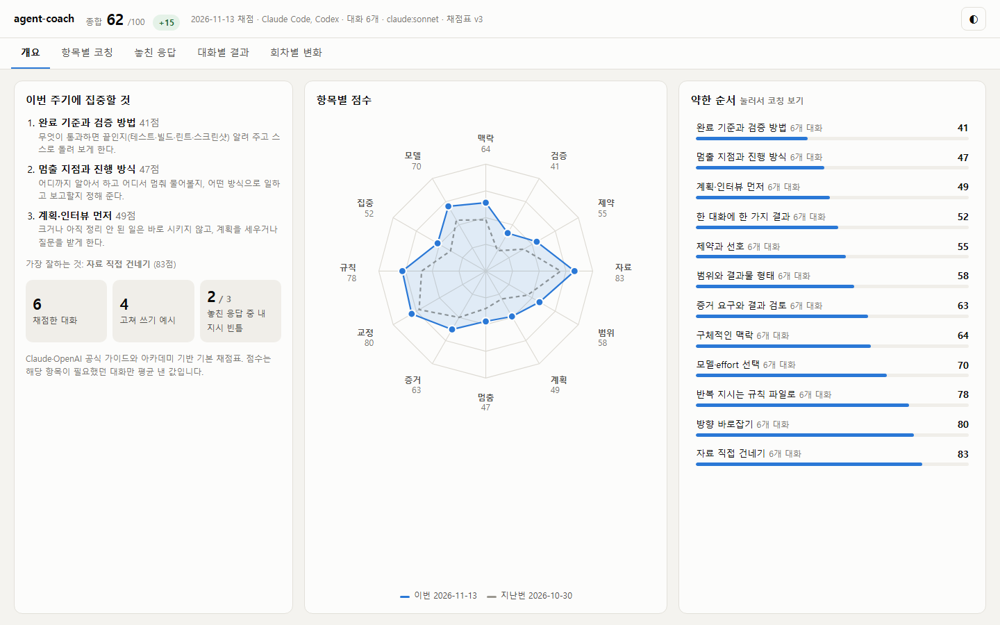
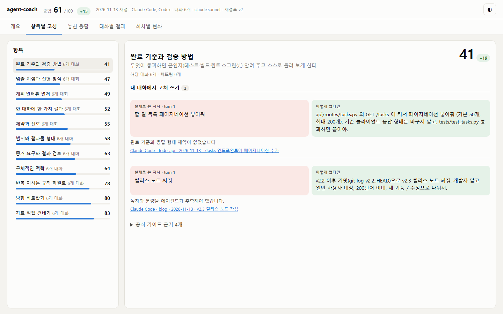
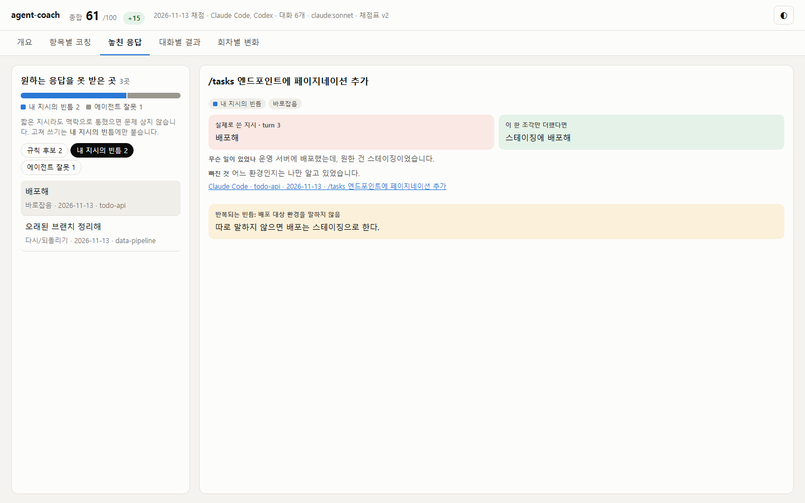

<div align="center">

<h1>agent-coach</h1>

<p><b>내 Claude Code·Codex 대화 기록을 Anthropic·OpenAI 공식 가이드 기준으로 채점하고, 지시 습관을 코칭해 주는 도구.</b></p>

<p>
  <a href="https://github.com/1017toa/agent-coach/blob/main/LICENSE"></a>
  <a href="https://pypi.org/project/agent-coach-cli/"></a>
  
  
  
  
</p>

<p>
  <a href="#빠른-시작">빠른 시작</a> ·
  <a href="#채점-항목">채점 항목</a> ·
  <a href="#놓친-응답-분석">놓친 응답</a> ·
  <a href="#자주-묻는-질문">FAQ</a> ·
  <a href="https://github.com/1017toa/agent-coach/blob/main/README.md">English</a>
</p>

<picture>
  <source media="(prefers-color-scheme: dark)" srcset="https://github.com/1017toa/agent-coach/raw/main/docs/images/ko-overview-dark.png">
  
</picture>

<sub>가상의 대화로 만든 데모 리포트입니다 (<code>python scripts/demo_report.py --lang ko</code>).</sub>

</div>

**agent-coach**는 Claude Code와 OpenAI Codex가 내 컴퓨터에 이미 저장해 둔 대화 기록(`~/.claude/projects`, `~/.codex/sessions`)을 읽어, Anthropic·OpenAI 공식 가이드와 아카데미에서 뽑은 11가지 습관으로 내가 AI에게 지시하는 방식을 채점하는 명령줄 도구입니다. 내가 실제로 쓴 지시를 더 나은 형태로 고쳐 주고, 원하는 응답을 못 받은 턴을 찾아 주며, 회차마다 점수를 쌓아 나아지고 있는지 보여 줍니다.

## 빠른 시작

```bash
pipx install agent-coach-cli    # 또는: uv tool install agent-coach-cli · pip install agent-coach-cli
agent-coach run
```

PyPI 패키지 이름은 `agent-coach-cli`이고, 설치되는 명령은 `agent-coach`입니다. `run`은 이미 로그인해 둔 `claude` 또는 `codex` CLI로 최근 대화를 채점하고, 결과를 저장한 뒤 HTML 리포트를 엽니다. API 키도, 서버도, 추가 의존성도 필요 없습니다. 채점 전에 대상만 보고 싶다면 `agent-coach scan`을 쓰세요. 모델을 부르지 않습니다.

### Claude Code·Codex 안에서 쓰기

플러그인을 설치하면 에이전트가 직접 채점을 돌리고 대화창에서 코칭해 줍니다. 따로 설치할 것이 없습니다.

```text
# Claude Code
/plugin install agent-coach --marketplace 1017toa/agent-coach
/agent-coach:coach
```

```bash
# Codex
codex plugin marketplace add 1017toa/agent-coach
codex plugin add agent-coach@agent-coach
```

그다음 Codex에게 "agent-coach로 내 지시 습관 채점해줘"라고 하면 됩니다. 스킬이 채점 대상을 먼저 보여 주고, 채점한 뒤, 약한 습관과 고쳐 쓰기, `CLAUDE.md` / `AGENTS.md`에 넣을 규칙까지 짚어 줍니다.

## 특징

- **공식 가이드에 근거**: 항목마다 출처 섹션이 붙어 있습니다. Claude Code 모범 사례, Claude 아카데미, Codex 모범 사례, OpenAI 아카데미 ([채점표](https://github.com/1017toa/agent-coach/blob/main/agentcoach/rubric/default.json)).
- **내 실제 지시를 고쳐 쓰기**: 일반론 대신 "이렇게 썼는데, 이렇게 썼다면 나았다. 이유는…"을 보여 줍니다.
- **짧은 지시는 감점하지 않음**: 대화가 길어지면 "응 해줘"로 충분할 때가 많습니다. 실제로 원하는 응답을 못 받았고 원인이 내 지시의 빈틈일 때만 코칭합니다.
- **적어 둘 규칙을 찾아 줌**: 여러 대화에서 반복되는 빈틈을 한 줄 규칙으로 묶고, 넣을 곳(`CLAUDE.md` / `AGENTS.md`, 메모리, 스킬, 훅)까지 알려 줍니다.
- **성장 기록**: 회차마다 `~/.agent-coach/history/`에 저장합니다. 원본 대화가 자동 삭제돼도 추이는 남습니다.
- **Claude Code와 Codex를 같은 기준으로**, 한 리포트에서 봅니다.
- **기본이 비공개**: 채점기로 보내기 전에 키·연락처를 가리고, 결과는 내 컴퓨터에만 남습니다.
- **한국어·영어**: 리포트, CLI, 코칭 문장 모두 두 언어로 (`--lang ko|en`).

## 지원 도구

| 도구 | 읽는 위치 | 비고 |
|---|---|---|
| Claude Code (CLI, 데스크톱, IDE) | `~/.claude/projects/**/*.jsonl` | 스크립트로 돌린 `claude -p`와 앱이 만든 메시지는 제외 |
| OpenAI Codex (CLI, IDE) | `~/.codex/sessions/**/rollout-*.jsonl` | `codex exec`와 에이전트가 띄운 세션은 제외 |

채점기: `claude` CLI, `codex` CLI, 또는 오프라인 키워드 채점(`--judge heuristic`).

## 동작 방식

```
~/.claude, ~/.codex 대화 기록
  │
  ● 수집      내가 직접 입력한 턴만 (자동화·슬래시 명령·앱 메시지 제외)
  │
  ● 가리기    키, 이메일, 전화·주민·카드 번호, 주소, 직접 등록한 이름
  │
  ● 채점      대화당 한 번, 내 claude / codex CLI로, 채점표 v2 (11개 습관)
  │
  ● 저장      ~/.agent-coach/history/run-*.json
  │
  ✓ 리포트    HTML 파일 하나: 개요 · 항목별 코칭 · 놓친 응답 · 대화별 결과 · 회차별 변화
```

## 채점 항목

11개 습관을 그 습관이 필요했던 대화에서만 0 / 1 / 2로 매기고, 평균을 0~100점으로 바꿉니다.

| 항목 | 공식 가이드가 권하는 것 |
|---|---|
| 구체적인 맥락 | 목표와 함께 파일·화면·증상을 처음부터 짚어 준다 |
| 완료 기준과 검증 방법 | 통과/실패를 가를 기준(테스트, 빌드, 스크린샷)을 주고 에이전트가 직접 돌리게 한다 |
| 제약과 선호 | 바꾸면 안 되는 것, 선호하는 방식을 말한다 |
| 자료 직접 건네기 | 설명 대신 @파일, 스크린샷, 전체 에러를 붙인다 |
| 범위와 결과물 형태 | 최소 버전인지 전체인지, 결과의 형식과 길이 |
| 계획·인터뷰 먼저 | 크거나 모호한 일은 만들기 전에 계획하거나 질문받는다 |
| 멈출 지점과 진행 방식 | 어디까지 혼자 하고 어디서 멈춰 물을지, 어떻게 보고할지 |
| 증거 요구와 결과 검토 | 실행한 명령, 출력, diff를 받고, 새 세션으로 검토한다 |
| 방향 바로잡기 | 두 번 고쳐도 안 되면 더 나은 지시로 새로 시작한다 |
| 반복 지시는 규칙 파일로 | 매번 하는 말은 CLAUDE.md, AGENTS.md, 스킬에 둔다 |
| 한 대화에 한 가지 결과 | 새 일은 새 대화에서, 긴 대화는 정리한다 |



## 놓친 응답 분석

대화에 맥락이 쌓이면 짧은 지시로도 충분합니다. agent-coach는 짧다는 이유로 감점하지 않습니다. 대신 바로 다음에 일어난 일로 **원하는 응답을 못 받은 턴**을 찾습니다.

- **신호**: 결과를 바로잡음, 앞서 한 말을 반복함, 다시 하거나 되돌리라고 함, 사고를 알림, 답답함을 드러냄, 에이전트가 되물어야 했음.
- **원인**: *내 지시의 빈틈*(나만 아는 정보가 빠졌고 맥락으로도 채워지지 않음) / *에이전트 잘못*(맥락은 충분했음) / *마음이 바뀜* / *외부 요인*.
- **코칭**: 내 지시의 빈틈에만 "이 한 조각만 더했다면" 형태로 고쳐 쓰기가 붙습니다. 반복되는 빈틈은 규칙 후보가 됩니다.



원인 분류는 LLM 채점에서만 됩니다. 키워드 채점은 신호만 찾고 원인은 미분류로 둡니다.

## 사용법

```bash
agent-coach scan        # 채점 대상만 미리 보기 (모델 호출 없음)
agent-coach run         # 채점 → 회차 저장 → 리포트 열기
agent-coach summary     # 최근 회차를 글로: 약한 습관, 고쳐 쓰기, 추가할 규칙
agent-coach history     # 회차별 점수표
agent-coach report      # 저장된 회차로 리포트 다시 만들기
```

| 옵션 | 뜻 |
|---|---|
| `--days 30` / `--all` | 기간 (기본: 지난 회차 이후, 첫 회차는 14일) |
| `--judge claude\|codex\|heuristic` | 채점기 (기본: 자동) |
| `--model sonnet` | 채점 모델 |
| `--max-sessions 20` | 채점할 최대 대화 수, 대화마다 모델 호출 한 번 |
| `--source claude` / `--source codex` | 한 도구만 |
| `--rubric my-rubric.json` | 강의·팀용 맞춤 채점표 |
| `--lang ko\|en` | 리포트와 코칭 언어 (기본: OS 언어 또는 `AGENT_COACH_LANG`) |

설치 없이 소스에서 실행: `python -m agentcoach run`. 최신 개발 버전: `pip install git+https://github.com/1017toa/agent-coach.git`.

**주기적으로 채점하기**: 1~2주마다 `agent-coach run`을 돌리면 새 대화만 채점해 추이에 더합니다. Claude Code는 기본 설정에서 30일 지난 대화를 지우므로 그보다 짧은 간격이 좋습니다.

## 다른 도구와 비교

| | agent-coach | 토큰·비용 집계 도구 (예: ccusage) | 프롬프트 평가 프레임워크 (예: promptfoo) |
|---|---|---|---|
| 보는 것 | **내가** 에이전트에 지시하는 방식 | 토큰과 비용 | 내 앱의 프롬프트와 모델 출력 |
| 입력 | 내 Claude Code / Codex 기록 | 내 Claude Code / Codex 기록 | 직접 작성한 테스트 케이스 |
| 결과 | 습관별 점수, 고쳐 쓰기, 놓친 턴, 추가할 규칙 | 사용량 표 | 통과/실패 표 |
| 대상 | 코딩 에이전트 활용을 배우는 개발자·팀·강의 | 예산 관리 | LLM 앱 개발 |

답하는 질문이 달라서 함께 써도 됩니다.

## 자주 묻는 질문

### Claude Code나 Codex 지시를 어떻게 더 잘 쓸 수 있나요?
`agent-coach run`을 돌리고 **항목별 코칭** 탭을 여세요. 가장 약한 습관 3개부터, 내가 실제로 쓴 지시와 고쳐 쓴 지시를 공식 가이드 근거와 함께 보여 줍니다. 1~2주 뒤 다시 돌려 **회차별 변화** 탭을 확인하세요.

### 내 대화가 어딘가로 전송되나요?
원본 기록은 내 컴퓨터를 떠나지 않습니다. LLM 채점을 쓰면 채점할 대화의 지시(가린 것)와 에이전트 행동 한 줄 요약이 로그인한 Claude 또는 Codex 계정으로 갑니다. 원래 대화가 오가던 곳입니다. `--judge heuristic`은 완전히 오프라인으로 채점합니다.

### API 키가 필요한가요?
아니요. 이미 로그인한 `claude` 또는 `codex` CLI로, 쓰고 있는 요금제 안에서 채점합니다. 둘 다 없으면 오프라인 키워드 채점으로 동작합니다.

### 한 번 돌리는 데 얼마나 드나요?
대화당 채점 호출 한 번이며, 쓰고 있는 요금제에서 나갑니다. `--max-sessions`로 상한을 두고, `agent-coach scan`으로 개수를 먼저 볼 수 있습니다.

### 짧게 쓴 지시가 왜 감점되지 않나요?
짧은 지시가 맞는 경우가 많기 때문입니다. 긴 논의 뒤의 "응 해줘"는 필요한 맥락을 다 갖고 있습니다. 다음 턴에서 빗나간 게 드러날 때만 코칭하고, 빠진 정보가 나만 알던 것일 때만 고쳐 씁니다.

### 강의나 팀용 채점표를 따로 쓸 수 있나요?
네. [`agentcoach/rubric/default.json`](https://github.com/1017toa/agent-coach/blob/main/agentcoach/rubric/default.json)을 복사해 항목과 예시를 고친 뒤 `--rubric your-rubric.json`으로 넘기세요. 영어 필드가 없는 채점표는 쓴 그대로 보입니다.

### 결과는 어디에 저장되나요?
`~/.agent-coach/history/run-*.json`(회차마다 한 파일)과 `~/.agent-coach/report.html`입니다. `AGENT_COACH_HOME`으로 위치를 바꿀 수 있습니다.

### 내 이름이나 회사명을 가리려면?
이름은 자동으로 확실히 찾을 수 없으니 `~/.agent-coach/redact.txt`에 한 줄에 하나씩(이름, 영문 이름, 회사명…) 적어 두세요. 키, 토큰, 이메일, 전화·주민·카드 번호, 도로명 주소는 자동으로 가립니다.

### Cursor, Gemini CLI, Aider도 되나요?
아직은 Claude Code와 Codex만 됩니다. 다른 도구 지원은 로드맵에 있고, 파서는 작습니다([`agentcoach/collect.py`](https://github.com/1017toa/agent-coach/blob/main/agentcoach/collect.py)).

## 출처

기본 채점표(v2)는 다음 자료로 만들었습니다.

- **Anthropic**: [Claude Code 모범 사례](https://code.claude.com/docs/en/best-practices), [Opus 5.5 활용 가이드](https://claude.dev/blog/getting-the-most-out-of-opus-5-5/)
- **Claude 아카데미**: [AI Fluency: Framework & Foundations](https://academy.claude.com/courses/ai-fluency-framework-foundations), [Claude Code 101](https://academy.claude.com/courses/claude-code-101), [Claude Code in Action](https://academy.claude.com/courses/claude-code-in-action), [Claude 101](https://academy.claude.com/courses/claude-101)
- **OpenAI**: [Codex Best practices](https://learn.chatgpt.com/guides/best-practices), [Codex Prompting](https://learn.chatgpt.com/docs/prompting)
- **OpenAI 아카데미**: [Get Started with Codex](https://academy.openai.com/public/courses/get-started-with-codex-jkhsq), [Agents and Workflows](https://academy.openai.com/public/courses/agents-and-workflows-y0qoc), [Extend Codex Workflows](https://academy.openai.com/public/courses/extend-codex-workflows-4e61p) (무료, 로그인 필요. 채점표는 네 칸 작업 지시, Plan 모드, 검증과 인계, 위임 계약, AGENTS.md 같은 구체적인 레슨을 근거로 씀)

채점표가 바뀌면 이전 회차에는 새 항목 점수가 없고, 리포트에 버전이 다르다고 표시됩니다.

## 로드맵

- 강의·팀용 익명 집계 내보내기
- 맞춤 채점표 예시
- Cursor, Gemini CLI 대화 기록 지원

## 기여

이슈와 PR 환영합니다. [CONTRIBUTING.md](https://github.com/1017toa/agent-coach/blob/main/CONTRIBUTING.md)를 참고하세요. 테스트:

```bash
python -m unittest discover -s tests
```

## 라이선스

[MIT](https://github.com/1017toa/agent-coach/blob/main/LICENSE)
