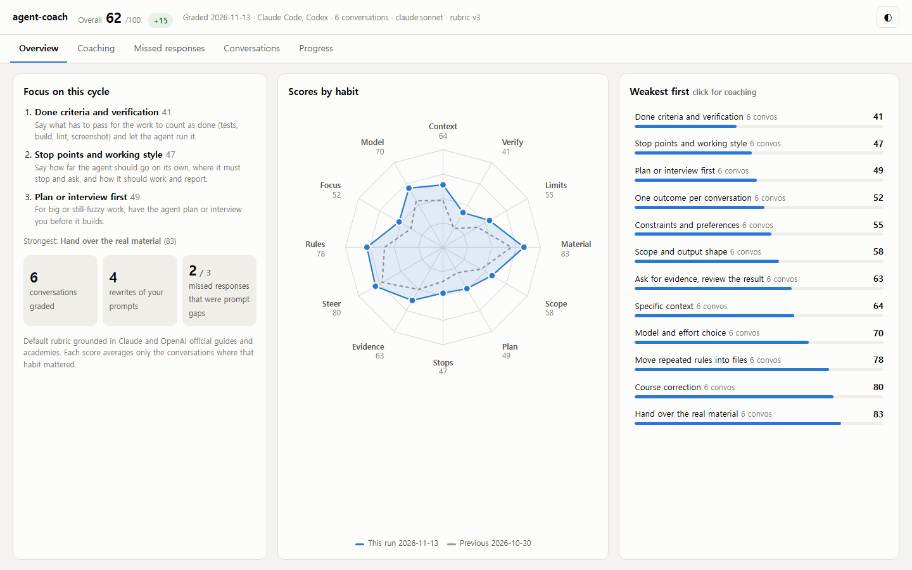
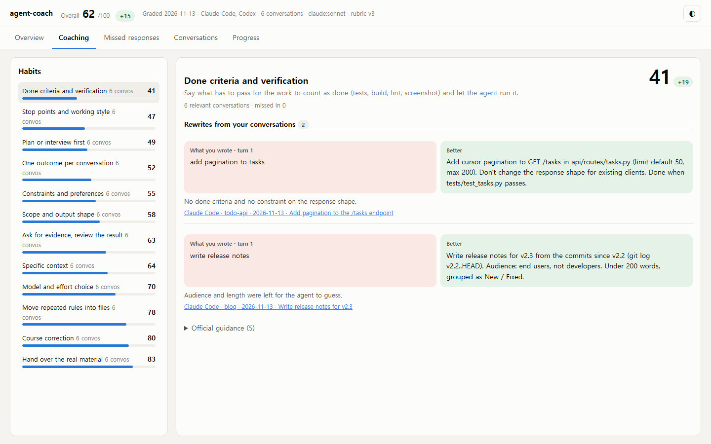
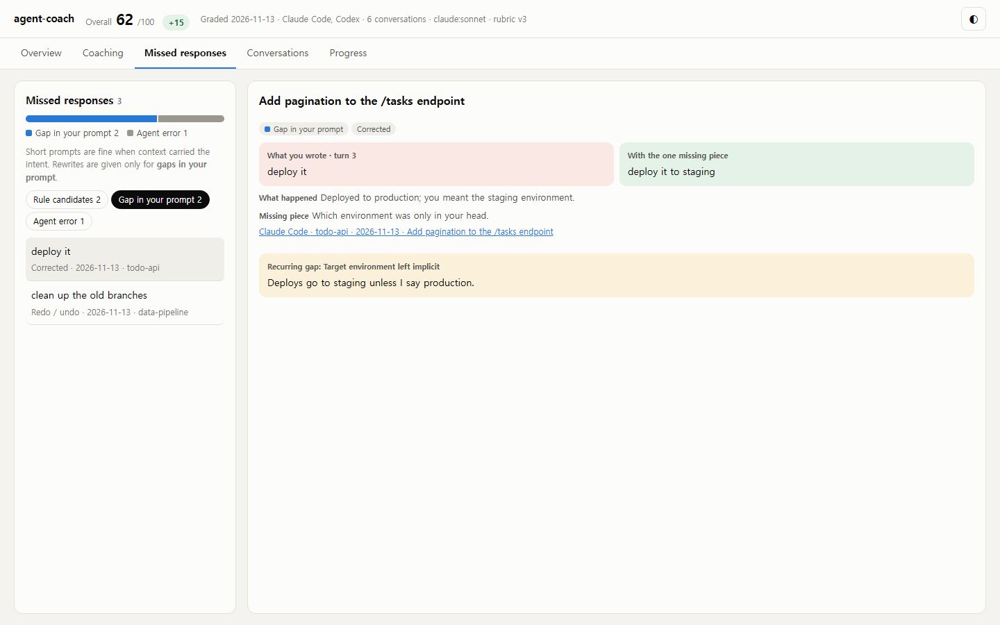

<div align="center">

<h1>agent-coach</h1>

<p><b>Grade and coach your Claude Code and Codex prompts from your own conversation history, against Anthropic's and OpenAI's official guides.</b></p>

<p>
  <a href="https://github.com/1017toa/agent-coach/blob/main/LICENSE"></a>
  <a href="https://pypi.org/project/agent-coach-cli/"></a>
  
  
  
  
</p>

<p>
  <a href="#quick-start">Quick start</a> ·
  <a href="#what-it-grades">What it grades</a> ·
  <a href="#missed-responses">Missed responses</a> ·
  <a href="#faq">FAQ</a> ·
  <a href="https://github.com/1017toa/agent-coach/blob/main/README.ko.md">한국어</a>
</p>

<picture>
  <source media="(prefers-color-scheme: dark)" srcset="https://github.com/1017toa/agent-coach/raw/main/docs/images/overview-dark.png">
  
</picture>

<sub>Demo report built from made-up conversations (<code>python scripts/demo_report.py</code>).</sub>

</div>

**agent-coach** is a command-line tool that reads the transcripts Claude Code and OpenAI Codex already save on your machine (`~/.claude/projects`, `~/.codex/sessions`) and scores how you direct the agent on 12 habits taken from the official Anthropic and OpenAI guides and academies. It rewrites prompts you actually typed into better versions, finds the turns where you didn't get what you wanted, and tracks your scores run after run so you can see whether you're improving.

## Quick start

```bash
pipx install agent-coach-cli    # or: uv tool install agent-coach-cli · pip install agent-coach-cli
agent-coach run
```

The package on PyPI is `agent-coach-cli`; the command it installs is `agent-coach`. `run` grades your recent conversations through the `claude` or `codex` CLI you're already signed in to, saves the result and opens an HTML report. No API key, no server, no dependencies. Want to look before grading anything? `agent-coach scan` lists what would be graded, without calling a model.

### Or use it inside Claude Code or Codex

Install the plugin and let the agent run it and coach you in the chat, with nothing else to install.

```text
# Claude Code
/plugin install agent-coach --marketplace 1017toa/agent-coach
/agent-coach:coach
```

```bash
# Codex
codex plugin marketplace add 1017toa/agent-coach
codex plugin add agent-coach@agent-coach
```

Then ask Codex to "grade my prompting with agent-coach". The skill previews what will be graded, runs the grading, and walks you through your weakest habits, rewrites and rules worth adding to `CLAUDE.md` / `AGENTS.md`.

## Highlights

- **Grounded in the official guides.** Every habit cites the guide section it comes from: Claude Code best practices, Claude Academy, Codex best practices, OpenAI Academy ([rubric](https://github.com/1017toa/agent-coach/blob/main/agentcoach/rubric/default.json)).
- **Rewrites of your real prompts.** "You wrote this; this would have worked better, because…", not generic tips.
- **Short prompts aren't penalized.** In a long conversation, "ok do it" is often all you need. Coaching targets turns that actually missed, and only when the cause was a gap in your prompt.
- **Finds rules worth writing down.** Gaps that recur across conversations become one-line rules, with where to put them: `CLAUDE.md` / `AGENTS.md`, memory, a skill, or a hook.
- **Tracks progress.** Each run is saved under `~/.agent-coach/history/`, so your trend survives after the tools delete old transcripts.
- **Claude Code and Codex on one scale**, in one report.
- **Private by default.** Secrets and contact details are masked before anything reaches the judge, and results stay on your machine.
- **English and Korean.** Report, CLI and coaching in either language (`--lang en|ko`).

## Supported tools

| Tool | Transcripts read from | Notes |
|---|---|---|
| Claude Code (CLI, desktop, IDE) | `~/.claude/projects/**/*.jsonl` | Scripted `claude -p` runs and app-generated turns are skipped |
| OpenAI Codex (CLI, IDE) | `~/.codex/sessions/**/rollout-*.jsonl` | `codex exec` and agent-spawned sessions are skipped |

Judge: `claude` CLI, `codex` CLI, or offline keyword scoring (`--judge heuristic`).

## How it works

```
~/.claude, ~/.codex transcripts
  │
  ● collect    your own typed turns only (automation, slash commands, app messages filtered out)
  │
  ● redact     keys, emails, phone / ID / card numbers, addresses, names you list
  │
  ● judge      one call per conversation via your claude / codex CLI, rubric v3 (12 habits)
  │
  ● save       ~/.agent-coach/history/run-*.json
  │
  ✓ report     one self-contained HTML file: overview · coaching · missed responses · conversations · progress
```

## What it grades

Twelve habits, each scored 0 / 1 / 2 only in the conversations where it mattered, averaged to 0–100.

| Habit | What the guides recommend |
|---|---|
| Specific context | State the goal and point at the file, screen and symptom from the start |
| Done criteria and verification | Give a pass/fail check (tests, build, screenshot) and let the agent run it |
| Constraints and preferences | Say what must not change and which approach you prefer |
| Hand over the real material | Attach the @file, screenshot or full error instead of describing it |
| Scope and output shape | Minimal or full version; format and length of the result |
| Plan or interview first | For big or fuzzy work, plan or get interviewed before building |
| Stop points and working style | How far to go alone, where to stop and ask, how to report |
| Ask for evidence, review the result | Commands, output, diff; a fresh session to review |
| Course correction | After two failed corrections, start fresh with a better prompt |
| Move repeated rules into files | Put recurring rules in CLAUDE.md, AGENTS.md or a skill |
| One outcome per conversation | New work in a new conversation; tidy long ones |
| Model and effort choice | Match model and reasoning effort to the work, judged from what each conversation actually ran on |



## Missed responses

Context builds up over a conversation, so a short instruction can be exactly right. agent-coach never marks a prompt down for being short. It looks for **turns that didn't get what you wanted**, judged by what happened next:

- **Signals**: you corrected the result, repeated an earlier instruction, asked to redo or undo, reported damage, showed frustration, or the agent had to ask back.
- **Causes**: *gap in your prompt* (something only you knew was missing and context didn't cover it) / *agent error* (context was enough) / *changed your mind* / *external limit*.
- **Coaching**: only prompt gaps get a rewrite, phrased as "the one missing piece". Gaps that recur become rule candidates.



Causes are classified only with an LLM judge; keyword scoring finds the signals and leaves the cause unclassified.

## Usage

```bash
agent-coach scan        # preview which conversations would be graded (no model calls)
agent-coach run         # grade → save the run → open the report
agent-coach summary     # latest run as text: weakest habits, rewrites, rules to add
agent-coach history     # score table per run
agent-coach report      # rebuild the report from saved runs
```

| Option | Meaning |
|---|---|
| `--days 30` / `--all` | Time window (default: since the previous run; 14 days on the first run) |
| `--judge claude\|codex\|heuristic` | Which judge (default: auto) |
| `--model sonnet` | Judge model |
| `--max-sessions 20` | Max conversations to grade; each one is one model call |
| `--source claude` / `--source codex` | Only one tool |
| `--rubric my-rubric.json` | Your own rubric, for a course or a team |
| `--lang en\|ko` | Language of the report and coaching (default: OS locale, or `AGENT_COACH_LANG`) |

From a checkout without installing: `python -m agentcoach run`. Latest development version: `pip install git+https://github.com/1017toa/agent-coach.git`.

**Grade on a schedule.** Run `agent-coach run` every week or two; each run grades only what's new and adds to the trend. Claude Code deletes transcripts older than 30 days by default, so keep the interval shorter than that.

## How it compares

| | agent-coach | Token and cost trackers (e.g. ccusage) | Prompt eval frameworks (e.g. promptfoo) |
|---|---|---|---|
| Looks at | How **you** direct the agent | Tokens and spend | Your app's prompts and model outputs |
| Input | Your Claude Code / Codex history | Your Claude Code / Codex history | Test cases you write |
| Output | Scores per habit, rewrites, missed turns, rules to add | Usage tables | Pass/fail matrices |
| For | Developers, teams and courses learning to work with coding agents | Budgeting | Building LLM apps |

They answer different questions and work fine side by side.

## FAQ

### How do I improve my Claude Code or Codex prompts?
Run `agent-coach run` and open the **Coaching** tab. It starts with your three weakest habits and shows prompts you actually wrote next to rewritten versions, with the official guide section behind each one. Re-run in a week or two and check the **Progress** tab.

### Does it send my conversations anywhere?
Raw transcripts never leave your machine. With an LLM judge, the masked prompts of each graded conversation and one-line summaries of what the agent did are sent to the Claude or Codex account you're signed in to, the same place your conversations already went. `--judge heuristic` grades fully offline.

### Do I need an API key?
No. Grading runs through the `claude` or `codex` CLI you're already logged in to, using your existing plan. Without either, it falls back to offline keyword scoring.

### How much does a run cost?
One judge call per conversation, on your existing plan. Use `--max-sessions` to cap it and `agent-coach scan` to preview the count first.

### Why wasn't my short prompt marked down?
Because short prompts are often right. "Yes, do it" after a long discussion has all the context it needs. agent-coach only coaches a turn when what happened next shows it missed, and only rewrites it when the missing piece was something only you knew.

### Can I use my own rubric for a course or a team?
Yes. Copy [`agentcoach/rubric/default.json`](https://github.com/1017toa/agent-coach/blob/main/agentcoach/rubric/default.json), edit the habits and examples, and pass `--rubric your-rubric.json`. A rubric without English fields is shown as written.

### Where are results stored?
`~/.agent-coach/history/run-*.json` (one file per run) and `~/.agent-coach/report.html`. Set `AGENT_COACH_HOME` to move them.

### How do I hide my name or company?
Names can't be detected reliably, so list yours (name, romanized name, company, ...) one per line in `~/.agent-coach/redact.txt`. Keys, tokens, emails, phone, national ID and card numbers, and Korean road addresses are masked automatically.

### Does it support Cursor, Gemini CLI or Aider?
Not yet; Claude Code and Codex only. Support for more tools is on the roadmap, and parsers are small (see [`agentcoach/collect.py`](https://github.com/1017toa/agent-coach/blob/main/agentcoach/collect.py)).

## Sources

The default rubric (v3) is built from:

- **Anthropic**: [Best practices for Claude Code](https://code.claude.com/docs/en/best-practices), [Model configuration](https://code.claude.com/docs/en/model-config), [Getting the most out of Opus 5.5](https://claude.dev/blog/getting-the-most-out-of-opus-5-5/)
- **Claude Academy**: [AI Fluency: Framework & Foundations](https://academy.claude.com/courses/ai-fluency-framework-foundations), [Claude Code 101](https://academy.claude.com/courses/claude-code-101), [Claude Code in Action](https://academy.claude.com/courses/claude-code-in-action), [Claude 101](https://academy.claude.com/courses/claude-101)
- **OpenAI**: [Codex Best practices](https://learn.chatgpt.com/guides/best-practices), [Codex Prompting](https://learn.chatgpt.com/docs/prompting)
- **OpenAI Academy**: [Get Started with Codex](https://academy.openai.com/public/courses/get-started-with-codex-jkhsq), [Agents and Workflows](https://academy.openai.com/public/courses/agents-and-workflows-y0qoc), [Extend Codex Workflows](https://academy.openai.com/public/courses/extend-codex-workflows-4e61p) (free with sign-in; the rubric cites specific lessons, such as the four-part task brief, Plan Mode, validation and handoff, delegation contracts and AGENTS.md)

When the rubric changes, earlier runs have no score for new habits and the report says the versions differ.

## Roadmap

- Anonymized aggregate export for courses and teams
- Example custom rubrics
- Cursor and Gemini CLI transcripts

## Contributing

Issues and pull requests are welcome; see [CONTRIBUTING.md](https://github.com/1017toa/agent-coach/blob/main/CONTRIBUTING.md). Run the tests with:

```bash
python -m unittest discover -s tests
```

## License

[MIT](https://github.com/1017toa/agent-coach/blob/main/LICENSE)
